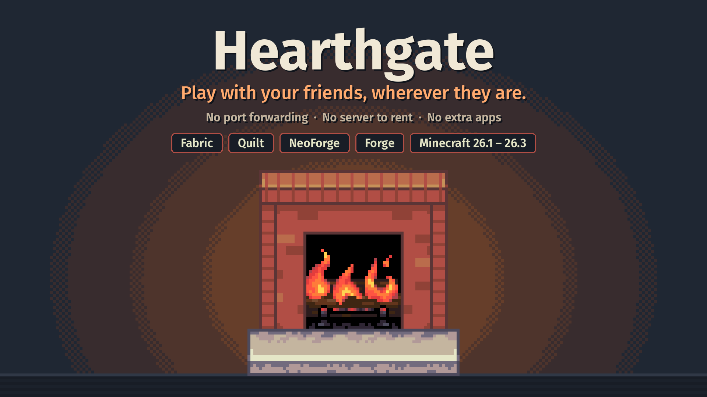
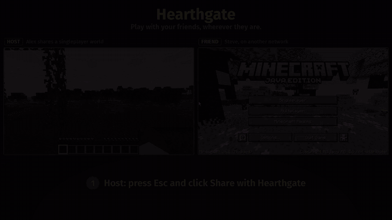

<!--
  Description for the Modrinth and CurseForge project pages. Paste everything
  below this comment into the page's description editor (both accept Markdown;
  on CurseForge choose the Markdown editor). Images load from GitHub, so push
  docs/ before publishing. Upload docs/media/step-*.png and docs/gallery.png
  to each site's gallery too. If a site strips the <iframe>, use its own
  "embed video" button with https://youtu.be/qOLP63FkhJg instead.
-->

**Play Minecraft with your friends, wherever they are.** No port forwarding, no server to rent, no extra apps, no accounts. Just the mod.

<iframe width="800" height="450" src="https://www.youtube.com/embed/qOLP63FkhJg" title="Hearthgate demo" frameborder="0" allow="encrypted-media; picture-in-picture" allowfullscreen></iframe>

## How it works for you

1. **Open your world**, press Esc, and click **Share with Hearthgate**.
2. Click **Copy Invitation** and send it to your friends (Discord DM, text, whatever you like).
3. Your friends go to **Multiplayer → Join with Hearthgate**, paste it, and click **Connect**.

That's it. They're in your world, and the share screen shows who is connected and whether each connection is direct or relayed.

## Why Hearthgate

- **Nothing to set up.** No router settings, no VPN to install, no sign-up.
- **Fast when it can be.** Players connect straight to each other whenever their networks allow it (most of the time), and through an encrypted relay when they don't.
- **Private.** Connections are end-to-end encrypted with WireGuard®. Your world is reachable only by people holding your invitation, and it isn't announced to your local network. Minecraft's own login, `/kick` and `/ban` still apply.
- **No native code.** The networking runs inside Minecraft's own Java process: no executables are downloaded or launched, and one jar works on Windows, macOS and Linux.
- **One jar for every supported Minecraft version** on each loader.
- **For servers too.** See below.

## Dedicated servers

Install the same jar on a dedicated server, and it stays reachable around the clock without opening a port:

- **Stable invitation** that survives restarts.
- **Automatic key rotation** (weekly by default) that never kicks anyone already playing. `/hearthgate rotate` retires a leaked invitation within seconds.
- **Discord announcements**: the server posts the invitation to a channel through a webhook and edits that same message when it changes.
- `/hearthgate status`, `/hearthgate invite`, `/hearthgate rotate`, `/hearthgate announce` for operators.
- Busy servers can add the optional **native add-on** (Linux, Windows, macOS) for more throughput.

Configuration details are in the [README](https://github.com/eranderlik/hearthgate#dedicated-servers).

## Requirements

- **Minecraft:** 26.1 – 26.3 (one jar for all)
- **Fabric:** Fabric Loader 0.19.5+ and Fabric API
- **Quilt:** use the Fabric jar with the regular Fabric API
- **NeoForge:** 26.1 or newer (`hearthgate-neoforge` jar)
- **Forge:** 62 or newer (`hearthgate-forge` jar)
- **Who needs it:** everyone, the host and every player who joins

## FAQ

**Do my friends need the mod?**
Yes. Everyone who joins through Hearthgate needs it installed, and should be on the same Minecraft version as the host. (If the versions differ, the join screen warns you before connecting.) As with any multiplayer game, your other mods still need to match.

**Is it safe?**
The invitation works like a password: anyone holding it can connect while you share, so send it privately. The tunnel is end-to-end encrypted, so relays can't read your traffic. Your world stays in online mode, which means joiners need genuine accounts, and `/kick`, `/ban` and the whitelist work as usual. Stopping sharing makes the invitation useless.

**Does it cost anything or need an account?**
No. Hearthgate uses Tailscale's free public Tailcat relays to help players find each other, and only sends traffic through them when a direct connection isn't possible. You don't need a Tailscale account.

**How is it different from Open to LAN?**
Open to LAN only works on your own network. Hearthgate works across the internet, and it doesn't expose your world to your local network.

**How is it different from other world-sharing mods?**
Many of them give you a public address that anyone can type in, and some let players join without the mod. Hearthgate instead uses private invitations, an end-to-end encrypted tunnel, direct peer-to-peer connections when possible, and dedicated-server hosting with key rotation. The trade-off is that every player needs the mod. Pick whichever fits your group.

**Can it get through school or work networks?**
Usually. If a direct connection is blocked, Hearthgate falls back to a relay over port 443 (the same port as normal websites). It can't get around networks that block it on purpose.

## Links

- [Demo video on YouTube](https://youtu.be/qOLP63FkhJg)
- [Source code and full documentation](https://github.com/eranderlik/hearthgate)
- [Report a bug](https://github.com/eranderlik/hearthgate/issues)

Hearthgate is built on Tailscale's open-source [Tailcat](https://github.com/tailscale/tailcat). It is an independent project, not affiliated with or endorsed by Tailscale. WireGuard is a registered trademark of Jason A. Donenfeld.
